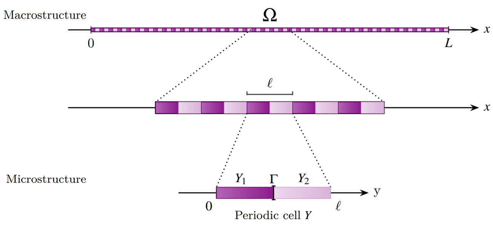
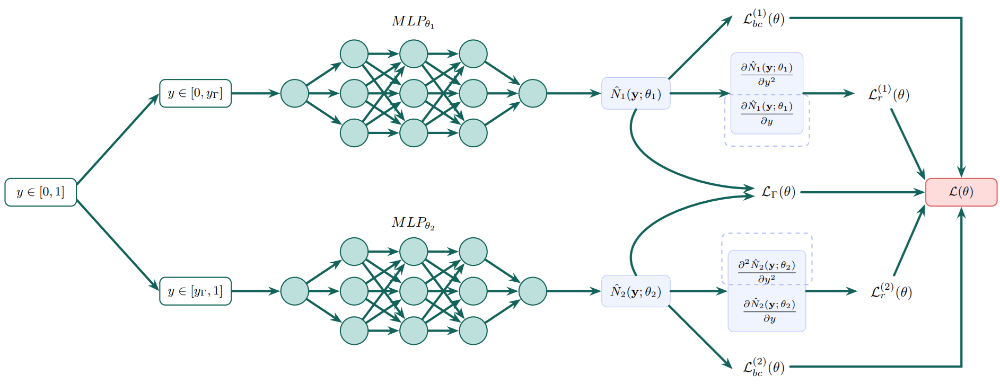
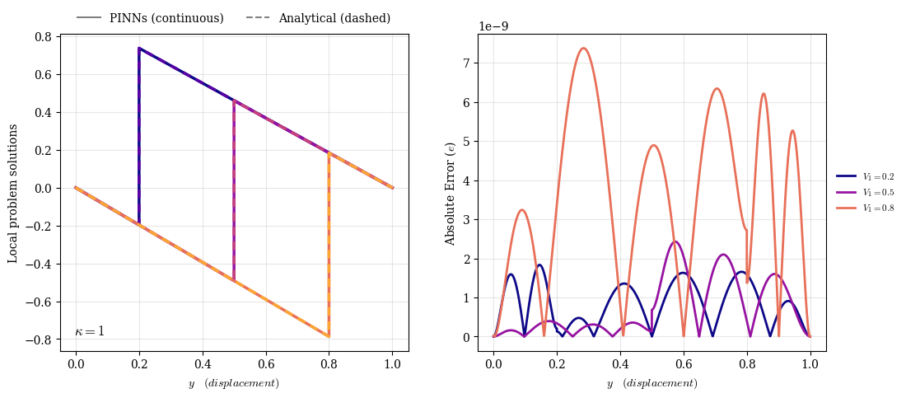
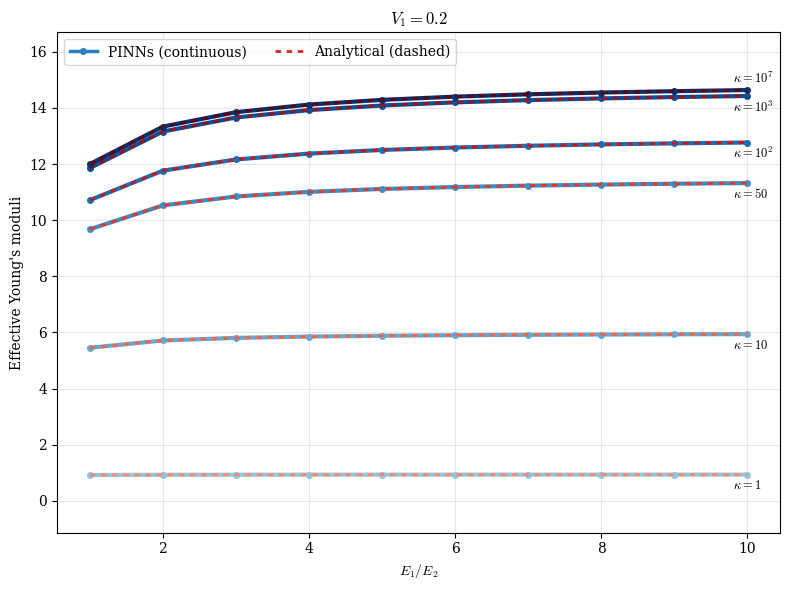
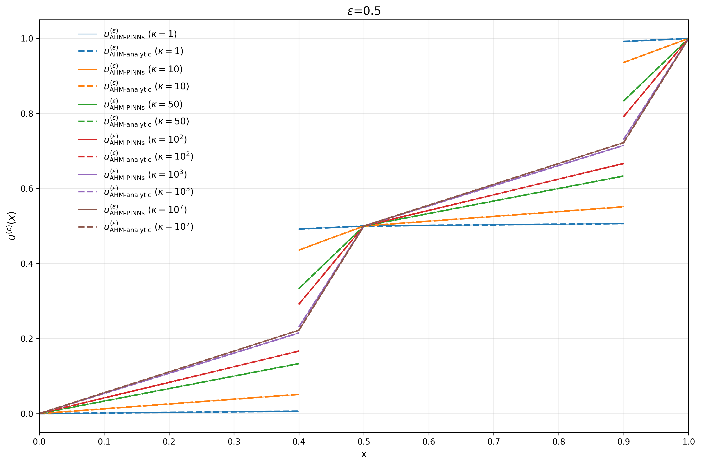

# `elastic_1D_imperfect`


This repository contains the code accompanying the manuscript:

> B. Mederos, Y. Espinosa-Almeyda, O. L. Cruz-González, R. Rodríguez-Ramos, and A. C. Alvarez (2026).  
> *Physics-Informed Neural Networks for Predicting Homogenized Effective Properties of One-Dimensional Composites with Imperfect Interface*.  
> Manuscript.

## Overview

This project combines the **Asymptotic Homogenization Method (AHM)** with **Physics-Informed Neural Networks (PINNs)** to study the effective elastic behavior of one-dimensional periodic composites with imperfect interfaces.

The PINN formulation uses separate neural networks in the material phases and incorporates the governing equations, boundary conditions, and interface conditions into the loss function. The numerical predictions are compared with the corresponding analytical homogenization solution.

<p align="center">
  
</p>

<p align="center"><em>One-dimensional periodic composite and its two-phase unit cell.</em></p>

## Mathematical formulation

The heterogeneous displacement field satisfies

$$
\frac{d}{dx}\left(E^{(\varepsilon)}(x)
\frac{du^{(\varepsilon)}(x)}{dx}\right)=0,
\qquad x\in(0,L),
$$

with boundary conditions

$$
u^{(\varepsilon)}(0)=0,
\qquad
u^{(\varepsilon)}(L)=1.
$$

At an imperfect interface, the traction is continuous and the displacement may exhibit a jump:

$$
\left[\!\left[ \sigma^{(\varepsilon)} \right]\!\right]=0,
\qquad
\sigma^{(\varepsilon)}
=
\frac{\kappa}{\varepsilon}
\left[\!\left[ u^{(\varepsilon)} \right]\!\right].
$$

Using the two-scale expansion

$$
u^{(\varepsilon)}(x)
\sim
u_0(x)
+\varepsilon N\left(\frac{x}{\varepsilon}\right)
\frac{du_0(x)}{dx},
$$

the local cell problem is

$$
\frac{d}{dy}
\left[
E(y)\left(1+\frac{dN(y)}{dy}\right)
\right]=0,
\qquad y\in Y_1\cup Y_2,
$$

subject to

$$
N_1(0)=0,
\qquad
N_2(1)=0,
$$

$$
E_1\left(1+N_1'(y_\Gamma)\right)
=
E_2\left(1+N_2'(y_\Gamma)\right),
$$

and

$$
E_1\left(1+N_1'(y_\Gamma)\right)
=
\kappa\left[N_2(y_\Gamma)-N_1(y_\Gamma)\right].
$$

The homogenized Young's modulus is computed as

$$
E^*
=
\left\langle
E(y)\left(1+N'(y)\right)
\right\rangle_Y.
$$

For the two-phase one-dimensional cell, the analytical expression is

$$
E^*
=
\frac{\kappa E_1E_2}
{E_1E_2+\kappa\left[E_2y_\Gamma+E_1(1-y_\Gamma)\right]}.
$$

The PINN approximation uses one neural network in each material phase and couples their predictions through the boundary and imperfect-interface conditions.

<p align="center">
  
</p>

<p align="center"><em>Dual-network PINN architecture used to solve the local problem.</em></p>

## Installation

The code has been tested with:

- Python **3.10**
- PyTorch **2.2.1**
- CUDA **11.8**, when GPU execution is available

Create a Conda environment:

```bash
conda create --name ahm-pinns-imperfect python=3.10
conda activate ahm-pinns-imperfect
```

Install PyTorch with CUDA support:

```bash
conda install pytorch==2.2.1 torchvision==0.17.1 torchaudio==2.2.1 pytorch-cuda=11.8 -c pytorch -c nvidia
```

For CPU-only execution:

```bash
conda install pytorch==2.2.1 torchvision==0.17.1 torchaudio==2.2.1 cpuonly -c pytorch
```

Install the remaining dependencies:

```bash
pip install numpy pandas matplotlib tqdm
```

Clone the repository:

```bash
git clone https://github.com/composites-pinns/elastic_1D_imperfect.git
cd elastic_1D_imperfect
```

## Getting Started

The numerical experiments are organized into two main folders:

- `Different_vf_FixedConstrast`
- `Different_Contrast`

The `optimizer` folder contains the optimizer used during training.

## Basic Usage

Run the training and prediction scripts from the corresponding experiment folder. For example:

```bash
python Different_vf_FixedConstrast/train_different_vf_fixedContrast.py
python Different_vf_FixedConstrast/prediction_different_vf.py
```

or

```bash
python Different_Contrast/train_different_contrast_vfractions.py
python Different_Contrast/prediction_different_contrast_vfractions.py
```

Generate the comparison figures and reconstructed displacement fields with:

```bash
python "Different_Contrast/show_C_vs_vf_ N_vs_y_fordifferent_k.py"
python Different_Contrast/reconstruction_analytical_vs_pinns.py
```

Some file paths may need to be adapted before execution.

## Results

The numerical results compare the PINN predictions with the analytical homogenization solution for the local fields, the effective elastic properties, and the reconstructed heterogeneous displacement.

<p align="center">
  
</p>

<p align="center"><em>Comparison of the analytical and PINN local solutions and their absolute error.</em></p>

<p align="center">
  
</p>

<p align="center"><em>Effective Young's modulus predicted by the PINN and obtained analytically.</em></p>

<p align="center">
  
</p>

<p align="center"><em>PINN-based and analytical reconstructions of the heterogeneous displacement field.</em></p>

## Citing

If you use this code, please cite the associated manuscript:

```bibtex
@unpublished{mederos2026imperfectinterface,
  title  = {Physics-Informed Neural Networks for Predicting Homogenized Effective Properties of One-Dimensional Composites with Imperfect Interface},
  author = {Mederos, Boris and Espinosa-Almeyda, Yoanh and Cruz-Gonz{\'a}lez, Oscar L. and Rodr{\'i}guez-Ramos, Reinaldo and Alvarez, Amaury C.},
  year   = {2026},
  note   = {Manuscript}
}
```

## License

This project is open source and available under the MIT License. See the [`LICENSE`](LICENSE) file for details.
